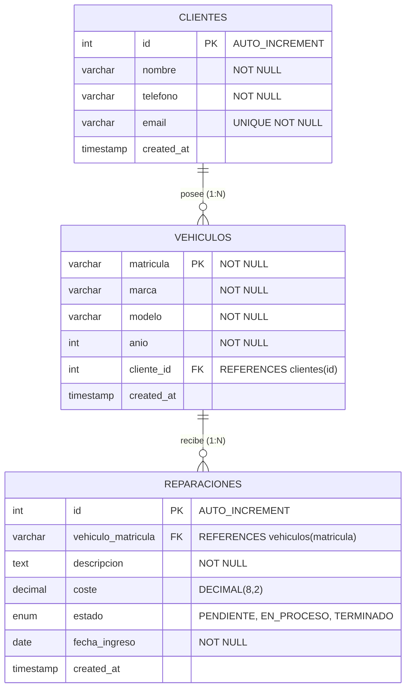

#  AutoGest Pro - Gestor de Mantenimiento y Reparaciones de Taller Mecánico
---

## Arquitectura del Sistema

El backend sigue un patrón estricto de **separación de responsabilidades por capas**:

```
src/main/java/com/taller/gestor/
├── TallerApplication.java       # Punto de entrada de la aplicación Spring Boot
├── config/                      # Configuración de CORS y recursos estáticos
│   └── CorsConfig.java
├── controller/                  # Endpoints REST y mapeo HTTP (JSON)
│   ├── ReparacionController.java
│   ├── VehiculoController.java
│   └── GlobalExceptionHandler.java # Respuestas semánticas de error (400, 404, 500)
├── service/                     # Lógica de negocio y transacciones
│   ├── ReparacionService.java
│   └── VehiculoService.java
├── dao/                         # Capa de persistencia JDBC pura (PreparedStatement)
│   ├── ClienteDao.java
│   ├── VehiculoDao.java
│   └── ReparacionDao.java
├── dto/                         # Data Transfer Objects para requests y responses
│   ├── ReparacionDetalleDto.java
│   ├── ReparacionRegistroDto.java
│   ├── CambiarEstadoRequest.java
│   ├── VehiculoDetalleDto.java
│   └── ErrorResponse.java
└── model/                       # Entidades de dominio
    ├── Cliente.java
    ├── Vehiculo.java
    ├── Reparacion.java
    └── EstadoReparacion.java (Enum: PENDIENTE, EN_PROCESO, TERMINADO)
```

##  Modelo de Base de Datos (MySQL)

El script [schema.sql](file:///c:/Users/Asus/Documents/PROYECTOS%20PERSONALES/Gestor%20de%20Mantenimiento%20y%20Reparaciones%20de%20Veh%C3%ADculos%20(Web%20con%20Java%20API%20+%20Vanilla%20JS)/schema.sql) genera la siguiente estructura:



---

## Endpoints de la API REST

La API maneja códigos HTTP semánticos y respuestas en formato JSON.

| Método | Endpoint | Descripción | Códigos HTTP |
| :--- | :--- | :--- | :--- |
| `GET` | `/api/reparaciones` | Listado de órdenes con datos de vehículo y cliente | `200 OK` |
| `POST` | `/api/reparaciones` | Registra una nueva orden de taller | `201 CREATED`, `400 BAD REQUEST` |
| `PATCH` | `/api/reparaciones/{id}/estado` | Actualiza inmediatamente el estado de la reparación | `200 OK`, `400 BAD REQUEST`, `404 NOT FOUND` |
| `GET` | `/api/vehiculos/{matricula}` | Verifica si el vehículo existe y devuelve su información | `200 OK`, `404 NOT FOUND` |

### Ejemplos de Peticiones

#### 1. Obtener reparaciones (`GET /api/reparaciones`)
```json
[
  {
    "id": 1,
    "matricula": "1234-KBC",
    "marca": "Volkswagen",
    "modelo": "Golf VII 2.0 TDI",
    "anio": 2017,
    "clienteNombre": "Carlos García Martínez",
    "clienteTelefono": "+34 612 345 678",
    "clienteEmail": "carlos.garcia@email.com",
    "descripcion": "Cambio de pastillas y discos de freno delanteros.",
    "coste": 240.50,
    "estado": "PENDIENTE",
    "fechaIngreso": "2026-10-25"
  }
]
```

#### 2. Registrar orden de trabajo (`POST /api/reparaciones`)
```json
{
  "vehiculoMatricula": "5678-LMN",
  "descripcion": "Sustitución de líquido de frenos y revisión de amortiguadores.",
  "coste": 120.00,
  "estado": "PENDIENTE",
  "fechaIngreso": "2026-10-27"
}
```

#### 3. Actualizar estado (`PATCH /api/reparaciones/1/estado`)
```json
{
  "estado": "EN_PROCESO"
}
```
*Valores permitidos:* `PENDIENTE`, `EN_PROCESO`, `TERMINADO`.

---

##  Frontend Vanilla JavaScript

El frontend está alojado en `src/main/resources/static/` y es servido directamente por Spring Boot:

- **Estructura modular:**
  - `js/api.js`: Abstracción completa de peticiones `fetch()` con control centralizado de errores.
  - `js/app.js`: Lógica de presentación, reactividad en cliente, filtros en vivo y manipulación del DOM.
  - `css/styles.css`: Estilos visuales con paleta de estados bien diferenciada:
    - 🟡 **Amarillo / Ámbar:** `PENDIENTE`
    - 🔵 **Azul:** `EN_PROCESO`
    - 🟢 **Verde:** `TERMINADO`
- **Interactividad instantánea:**
  - Selector interactivo de estado que envía `PATCH` al backend y actualiza colores y métricas sin recargar la página.
  - Comprobador en tiempo real de vehículos por matrícula antes de registrar la orden.
  - Filtros instantáneos por estado y barra de búsqueda combinada (matrícula, modelo, cliente o avería).

---

## Guía de Instalación y Ejecución

### Requisitos previos
- **Java JDK 17** o superior instalado.
- **MySQL Server 8.x** (o MariaDB / XAMPP) en ejecución.
- **Apache Maven 3.8+** (o el wrapper de Maven).

### Paso 1: Configurar la Base de Datos
Accede a tu cliente MySQL (MySQL Workbench, DBeaver, HeidiSQL o terminal) y ejecuta el script:
```sql
SOURCE schema.sql;
```
Esto creará la base de datos `taller_mecanico_db`, las 3 tablas y cargará datos semilla de demostración.

### Paso 2: Configurar credenciales
Edita [application.properties](file:///c:/Users/Asus/Documents/PROYECTOS%20PERSONALES/Gestor%20de%20Mantenimiento%20y%20Reparaciones%20de%20Veh%C3%ADculos%20(Web%20con%20Java%20API%20+%20Vanilla%20JS)/src/main/resources/application.properties) si tu usuario o contraseña de MySQL son diferentes:
```properties
spring.datasource.url=jdbc:mysql://localhost:3306/taller_mecanico_db?useSSL=false&serverTimezone=UTC&allowPublicKeyRetrieval=true&characterEncoding=UTF-8
spring.datasource.username=root
spring.datasource.password=root
```

### Paso 3: Compilar y Ejecutar el Backend
Desde la terminal en la raíz del proyecto:
```bash
mvn clean spring-boot:run
```

O empaquetar en un archivo JAR autónomo:
```bash
mvn clean package
java -jar target/gestor-reparaciones-1.0.0.jar
```

### Paso 4: Abrir la Aplicación
Abre tu navegador web y entra a:
```
http://localhost:8080
```
La interfaz de usuario cargará automáticamente, consultando la API en el mismo puerto.

